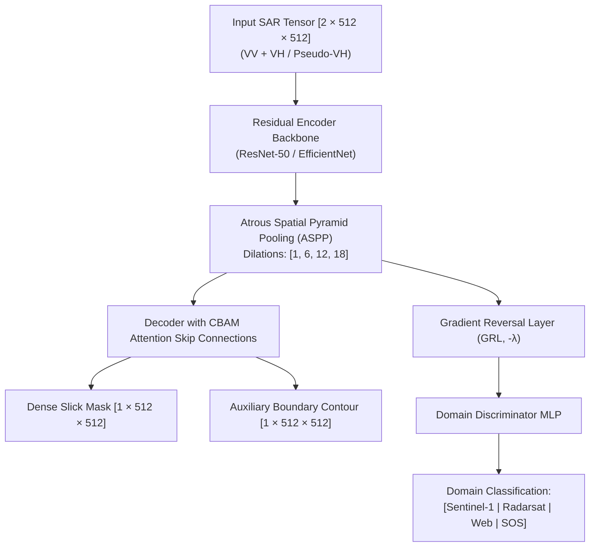
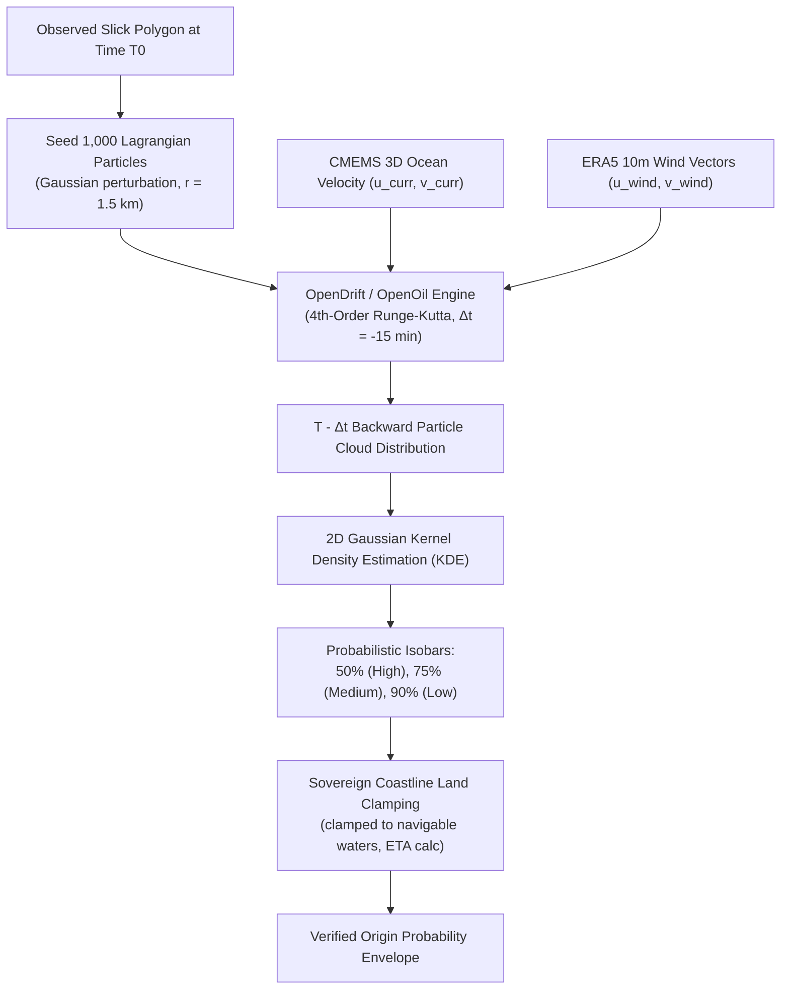
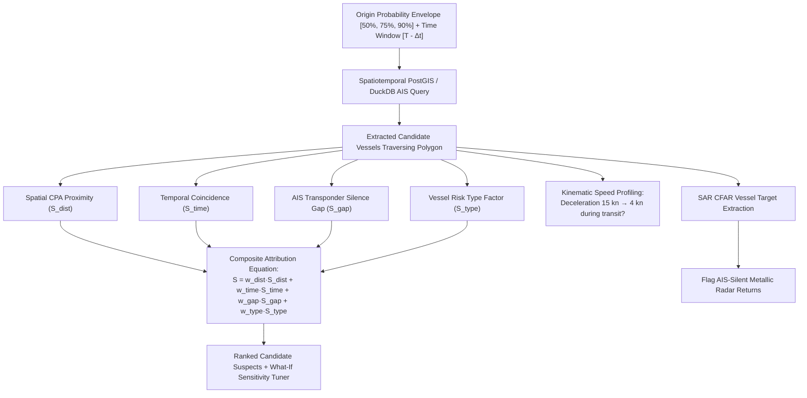
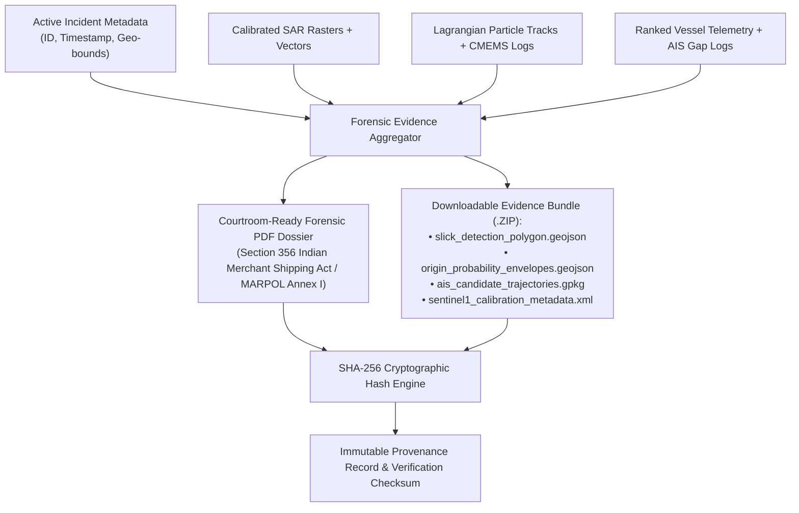
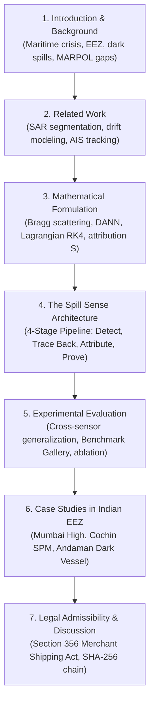

# 🛢️ Spill Sense: Comprehensive Technical & Research Reference Report

**Project Title:** Spill Sense — Autonomous Satellite Oil Spill AI Detection, Backward Lagrangian Drift Reconstruction, and Dark-Vessel Forensic Attribution  
**Team:** BUG STALKERS &nbsp;|&nbsp; **Problem Statement:** SIH26143 &nbsp;|&nbsp; **Category:** Software / Disaster Management / Maritime Domain Awareness  
**Target Domain:** Sovereign Maritime Surveillance, Environmental Law Enforcement, Operational Decision Support  

---

## 1. Executive Overview & Problem Definition

### 1.1 The Operational & Ecological Context
India’s Exclusive Economic Zone (EEZ) spans over **2.37 million square kilometers**, through which over **70% of the world’s seaborne petroleum traffic** transits (from the Persian Gulf across the Arabian Sea, around peninsular India, and through the Malacca Strait). In commercial shipping, rogue operators frequently discharge oily bilge water, tank washing residues, and bunker sludge under cover of darkness or heavy monsoon cloud cover to evade port discharge fees and regulatory oversight.

When authorities attempt to address maritime spills, they face **four fundamental operational bottlenecks**:
1. **The Satellite "Look-Alike" Dilemma:** Low-wind calm seas, biogenic algal blooms, internal waves, and ship wakes damp capillary waves similarly to mineral oil on Synthetic Aperture Radar (SAR), leading to high false-alarm rates ($>15\%$) in manual or naive automated screening.
2. **The "Static Location" Fallacy:** Ocean surface currents and atmospheric winds constantly transport and deform surface slicks. **The coordinates where a satellite detects a slick are never the coordinates where the discharge occurred.** Treating the detection point as the release site causes search vessels to investigate the wrong maritime fairway.
3. **The "Dark Vessel" Evasion Tactic:** Offending vessels intentionally disable their Automatic Identification System (AIS) transponders during illegal dumping, disappearing from conventional tracking radars.
4. **Evidentiary Inadmissibility:** Maritime courts and regulatory tribunals (e.g., under MARPOL 73/78 and the Indian Merchant Shipping Act, 1958) require continuous chain-of-custody, verifiable sensor calibration, and reproducible physics-based attribution—not heuristic guesswork or unverified screenshots.

### 1.2 The Core Operational Pipeline
Spill Sense resolves these bottlenecks through an integrated, 4-stage pipeline:
$$\mathbf{DETECT} \;\longrightarrow\; \mathbf{TRACE\;BACK} \;\longrightarrow\; \mathbf{ATTRIBUTE} \;\longrightarrow\; \mathbf{PROVE}$$


---

## 2. Stage 1: DETECT — Satellite Ingestion, Radiometric Invariance & Deep Learning

### 2.1 Satellite Constellations & Sensors Ingested
* **Copernicus Sentinel-1 (C-band, 5.405 GHz):** Interferometric Wide (IW) swath Ground Range Detected (GRD) products at $10\text{ m}$ spatial resolution with dual polarization ($\text{VV} + \text{VH}$).
* **ISRO EOS-04 / RISAT-1A (C-band, 5.35 GHz):** High-resolution Indian radar remote sensing granules.
* **NASA-ISRO SAR (NISAR):** Dual-frequency L-band ($1.26\text{ GHz}$) and S-band ($3.2\text{ GHz}$) providing multi-frequency damping characterization.
* **OpenSearch / STAC 1.0.0 Clients:** Automated ingestion via Copernicus Data Space Ecosystem (CDSE) OData and ISRO NRSC Bhoonidhi APIs.

### 2.2 Physical Bragg Scattering & Capillary Damping
SAR detects surface features through **Bragg resonance scattering** off short gravity-capillary surface waves ($\lambda_{\text{Bragg}} = \frac{\lambda_{\text{radar}}}{2 \sin \theta_{\text{inc}}}$).
* Clean seawater generates rough micro-facets, yielding high radar backscatter ($\sigma_0 \approx -12\text{ dB}$ to $-18\text{ dB}$).
* Mineral oil increases viscoelastic damping, flattening capillary ripples and causing specular reflection away from the satellite, manifesting as dark patches ($\sigma_0 \approx -22\text{ dB}$ to $-28\text{ dB}$, damping ratio $\Delta \sigma_0 = -4.5\text{ dB}$ to $-8.0\text{ dB}$).

### 2.3 Universal Radiometric Invariance Preprocessing Engine
To eliminate domain shift across raw 16-bit GeoTIFFs, GIS false-color stretches, and 8-bit web screenshots, the system employs three algorithmic steps:

#### A. 2D Swath Polynomial Background Detrending
Radar backscatter naturally drops across wide swaths due to antenna gain patterns and incidence angle roll-off ($30^\circ \to 45^\circ$), often causing false positives along the outer swath. The system fits a 2D surface to the large-scale marine background and subtracts it:
$$I_{\text{detrended}}(x, y) = I(x, y) - S(x, y) + \mu_{\text{ambient}}$$
Where $S(x, y)$ is a fitted polynomial (planar or quadratic):
$$S(x, y) = ax^2 + by^2 + cxy + dx + ey + f$$
This removes large-scale gradients while preserving sharp, localized oil slick filaments.

#### B. Adaptive Marine Cumulative Distribution Function (CDF) Normalization
Display gamma ($\gamma = 2.2$) and JPEG compression distort 8-bit web images. The system extracts marine pixels (excluding land $>165$ and synthetic letterboxes $<12$) and maps their CDF to canonical radar backscatter:
$$\hat{I}(x, y) = \mu_{\text{ref}} + \sigma_{\text{ref}} \cdot \frac{I(x, y) - \mu_{\text{marine}}}{\sigma_{\text{marine}}}$$
This maps the background open ocean to $\approx 0.62$ and oil slicks to $[0.10, 0.30]$ across all sources.

#### C. Physics-Derived Pseudo-VH Synthesizer
When single-polarization ($\text{VV}$) imagery is provided, a synthetic cross-polarization ($\text{VH}$) channel is generated based on ocean polarimetric physics:
$$\text{VH}_{\text{synth}} = \max\left(0.0, \;\text{VV} - 0.05 + 0.04 \cdot \text{clip}\left(\frac{\mu_{\text{sea}} - \text{VV}}{\mu_{\text{sea}}}, 0.0, 1.0\right)\right)$$

### 2.4 Neural Network Architectures



1. **Atrous Spatial Pyramid Pooling (ASPP):** Dilated convolutions with rates $[1, 6, 12, 18]$ provide multi-scale receptive fields, enabling simultaneous detection of $2\text{ px}$-wide bilge discharge tracks and large $5\text{ km}$ crude pools.
2. **CBAM (Convolutional Block Attention Module):** Applies channel attention (focusing on the most discriminative polarization) and spatial attention (suppressing landmasses and speckle noise).
3. **Domain-Adversarial Neural Network (DANN):** Implements a minimax objective using a Gradient Reversal Layer (GRL) with progress parameter $\lambda_p = \frac{2}{1 + \exp(-10p)} - 1$. The feature extractor learns representations discriminative for oil slicks but invariant to satellite sensor or web format.
4. **Auxiliary Boundary Head:** Predicts a 1-pixel boundary contour alongside the dense mask, preventing fuzzy edges that degrade hydrodynamic back-trajectory seeding.

### 2.5 Multi-Task Loss Formulation
$$\mathcal{L}_{\text{Total}} = \mathcal{L}_{\text{Focal}} + 2.0 \cdot \mathcal{L}_{\text{Tversky}} + 1.5 \cdot \mathcal{L}_{\text{Boundary}} + 0.5 \cdot \mathcal{L}_{\text{Domain}}$$
* **Focal Loss:** $\mathcal{L}_{\text{Focal}} = -\alpha_t (1 - p_t)^\gamma \log(p_t)$ ($\gamma = 2.0, \alpha = 0.75$), focusing gradient updates on hard boundary pixels.
* **Tversky Loss:** $\mathcal{L}_{\text{Tversky}} = 1 - \frac{\text{TP} + \epsilon}{\text{TP} + \alpha \text{FP} + \beta \text{FN} + \epsilon}$ with $\beta = 0.7$ and $\alpha = 0.3$, heavily penalizing False Negatives to preserve faint filaments.
* **Boundary Loss:** Penalizes geodesic distance between ground-truth and predicted perimeters.

### 2.6 Dual-Frequency Damping Index (DFDI) & Look-Alike Rejection
* **Wind Exclusion Filter:** Evaluates ECMWF ERA5 $10\text{ m}$ wind velocity ($U_{10}$). SAR detection is valid between $3.0\text{ m/s} \le U_{10} \le 12.0\text{ m/s}$. Winds $<3\text{ m/s}$ produce calm sea look-alikes; winds $>12\text{ m/s}$ mix slicks into the water column.
* **Dual-Frequency Damping Index (NISAR L+S Band):**
  $$\text{DFDI} = \frac{\Delta \sigma_{0,\text{S-band}} - \Delta \sigma_{0,\text{L-band}}}{\Delta \sigma_{0,\text{S-band}} + \Delta \sigma_{0,\text{L-band}}}$$
  Mineral crude oil dampens both S-band ($3.2\text{ GHz}$) and L-band ($1.26\text{ GHz}$), whereas biogenic algal films only damp high-frequency S-band capillary waves, yielding distinct signatures.

---

## 3. Stage 2: TRACE BACK — Hydrodynamic Backward & Forward Drift Physics



### 3.1 Lagrangian Governing Equations
Drift trajectory modeling uses OpenDrift / OpenOil with 4th-order Runge-Kutta (RK4) numerical integration.
Each particle’s displacement velocity vector $\vec{V}_{\text{particle}}$ is:
$$\vec{V}_{\text{particle}}(x, y, t) = \vec{U}_{\text{current}}(x, y, z=0, t) + \alpha_{\text{wind}} \cdot \vec{U}_{\text{wind}, 10\text{m}}(x, y, t) + \vec{U}_{\text{diffusion}}^{\prime}$$

* **$\vec{U}_{\text{current}}$:** Ocean surface current vector from Copernicus Marine Service (CMEMS) global reanalysis / INCOIS regional models ($1/12^\circ$ resolution).
* **$\vec{U}_{\text{wind}, 10\text{m}}$:** $10\text{ m}$ atmospheric wind velocity from ECMWF ERA5.
* **$\alpha_{\text{wind}}$:** Stokes drift windage factor ($3.0\% \text{ to } 3.5\%$, direction aligned or deflecting $0^\circ\text{–}15^\circ$ via Coriolis force).
* **$\vec{U}_{\text{diffusion}}^{\prime}$:** Stochastic turbulent diffusion:
  $$\vec{U}_{\text{diffusion}}^{\prime} = \mathcal{R} \sqrt{\frac{2 K_h}{\Delta t}}$$
  Where $K_h = 10\text{ m}^2/\text{s}$ is horizontal diffusivity and $\mathcal{R} \sim \mathcal{N}(0, 1)$.

### 3.2 Backward Lagrangian Reconstruction (Negative Timestepping)
To locate the release point, integration runs backward in time:
$$\vec{x}(t - \Delta t) = \vec{x}(t) - \int_{t-\Delta t}^{t} \vec{V}_{\text{particle}}(\vec{x}, \tau) \, d\tau$$
* Particle count: $N = 1,000$ particles seeded across the slick polygon.
* Integration time step: $\Delta t = -15\text{ minutes}$.
* Backtracking window: Up to $T - 72\text{ hours}$.

### 3.3 Monte Carlo Kernel Density Estimation (KDE)
The backward particle distribution at candidate discharge intervals forms a continuous probability density surface via Gaussian KDE:
$$\hat{f}(\mathbf{x}) = \frac{1}{N h^2 2\pi} \sum_{i=1}^N \exp\left(-\frac{\|\mathbf{x} - \mathbf{X}_i\|^2}{2h^2}\right)$$
Thresholding the cumulative distribution generates nested origin probability envelopes:
* **$50\%$ Probability Envelope (High Confidence Core):** Inner kernel where the discharge most likely occurred.
* **$75\%$ Probability Envelope (Medium Confidence).**
* **$90\%$ / $95\%$ Probability Envelope (Outer Dispersion Boundary).**

### 3.4 Sovereign Peninsular Land Clamping & Landfall ETA
Standard numerical models can artificially project particles onto mainland coordinates. Spill Sense implements boundary clamping (`geoContours.ts`):
* Forward and backward vectors are tested against the Indian sovereign coastline baseline (WGS84).
* Particles reaching the shoreline are arrested ($\vec{V} = 0$), accumulating as "beached oil."
* Dynamic forward simulation yields the **Landfall ETA**, providing response coordinates for containment booms.

---

## 4. Stage 3: ATTRIBUTE — AIS Vessel Correlation & Dark-Vessel Diagnostics



### 4.1 Spatiotemporal Candidate Extraction
The system queries all historical AIS records (via PostGIS spatial indexes and DuckDB Spatial) intersecting the origin probability envelope during the discharge window $[t_{\text{discharge}} - \delta t, \; t_{\text{discharge}} + \delta t]$:
$$\text{ST\_Intersects}(\text{VesselTrajectory}, \;\text{OriginPolygon}_{90\%}) \quad \wedge \quad t_{\text{vessel}} \in [t_{\text{start}}, t_{\text{end}}]$$

### 4.2 Multi-Factor Attribution Scoring Equation
Each candidate vessel is scored using a multi-factor formula:
$$S_{\text{total}} = w_{\text{dist}} \cdot S_{\text{dist}} + w_{\text{time}} \cdot S_{\text{time}} + w_{\text{gap}} \cdot S_{\text{gap}} + w_{\text{type}} \cdot S_{\text{type}}$$
Subject to: $\sum w_i = 1.0$ (default weights: $w_{\text{dist}} = 0.35, \; w_{\text{time}} = 0.25, \; w_{\text{gap}} = 0.25, \; w_{\text{type}} = 0.15$).

#### Sub-Score Formulations:
1. **Spatial Proximity Score ($S_{\text{dist}}$):** Based on the Closest Point of Approach (CPA) to the origin envelope centroid:
   $$S_{\text{dist}} = \exp\left(-\frac{d_{\text{CPA}}}{R_{\text{uncertainty}}}\right)$$
   Where $d_{\text{CPA}}$ is calculated via the Haversine/geodesic great circle metric:
   $$d = 2R \arcsin \sqrt{\sin^2\left(\frac{\Delta \phi}{2}\right) + \cos \phi_1 \cos \phi_2 \sin^2\left(\frac{\Delta \lambda}{2}\right)}$$
2. **Temporal Overlap Score ($S_{\text{time}}$):** Measures alignment between the vessel's passage and the back-calculated release time:
   $$S_{\text{time}} = \exp\left(-\frac{|t_{\text{vessel}} - t_{\text{origin}}|}{\tau_{\text{decay}}}\right)$$
3. **AIS Gap Score ($S_{\text{gap}}$):** Evaluates transponder silence near the probability envelope:
   $$S_{\text{gap}} = \min\left(1.0, \;\frac{\Delta t_{\text{blackout}}}{\Delta t_{\text{suspicious\_thresh}}}\right)$$
4. **Vessel Type Factor ($S_{\text{type}}$):**
   * Crude Oil Tanker / VLCC: $1.00$
   * Product / Chemical Tanker: $0.85$
   * Bulk Cargo / Container Carrier (Heavy Bunker): $0.70$
   * Offshore Support / Trawler: $0.35$

### 4.3 AIS Gap Diagnostics & Dark-Vessel Interception
1. **Gap Classification:** Transmission gaps are categorized as:
   * **Normal:** $\Delta t < 30\text{ min}$ (line-of-sight terrestrial antenna shadow).
   * **Uncertain:** $30\text{ min} \le \Delta t \le 2\text{ hours}$ in low-traffic waters.
   * **Suspicious:** $\Delta t > 2\text{ hours}$ inside or adjacent to the origin envelope.
2. **Speed Profile Anomaly Detection:** Vessel trajectories are scanned for sudden decelerations (e.g., cruising at $14.5\text{ kn}$, dropping to $4.1\text{ kn}$ inside the origin envelope, then accelerating back to transit speed)—a kinematic indicator of bilge or sludge discharge.
3. **SAR Vessel Detection vs. AIS Cross-Referencing:** A Constant False Alarm Rate (CFAR) detector isolates bright metallic radar scatterers ($\sigma_0 > 0\text{ dB}$) in the SAR scene. If a high-intensity target has no corresponding AIS broadcast, it is cataloged as a **Confirmed Dark Vessel**.

---

## 5. Stage 4: PROVE — Cryptographic Integrity & Regulatory Framework



### 5.1 Bonn Agreement Appearance Code & Volume Estimation
Discharged volume is quantified using the international **Bonn Agreement Oil Appearance Codes (BAOAC)**:

$$\text{Volume } (V) = \sum_{k=1}^5 \text{Area}_k \cdot \text{Thickness}_k$$

| Bonn Code | Appearance / Layer Description | Layer Thickness ($\mu\text{m}$) | Nominal Volume Factor ($\text{m}^3/\text{km}^2$) |
|---|---|---|---|
| **Code 1** | Sheen (silvery / grey) | $0.04\text{ to } 0.30$ | $0.1$ |
| **Code 2** | Rainbow | $0.30\text{ to } 5.00$ | $1.0$ |
| **Code 3** | Metallic | $5.00\text{ to } 50.0$ | $10.0$ |
| **Code 4** | Discontinuous True Oil Colors | $50.0\text{ to } 200.0$ | $100.0$ |
| **Code 5** | Continuous True Oil Colors (Heavy Emulsion) | $>200.0$ | $\ge 200.0$ |

The model segments the high-viscosity emulsion core (Bonn 4/5) and surrounding iridescent sheen (Bonn 1/2) to compute volume in both metric tons ($\text{MT}$) and barrels ($\text{bbl}$):
$$M_{\text{metric tons}} = V_{\text{m}^3} \cdot \rho_{\text{oil}} \quad (\rho_{\text{crude}} \approx 0.86\text{–}0.92\text{ t/m}^3)$$

### 5.2 Cryptographic Chain of Custody & SHA-256 Hashing
Every generated forensic dossier and associated geospatial artifact is sealed with a **SHA-256 cryptographic digest**:
$$H = \text{SHA-256}(\text{RawRaster} \;||\; \text{ModelParams} \;||\; \text{GeoJSONVectors} \;||\; \text{AISLogs} \;||\; \text{PDFBytes})$$
* Guarantees tamper-evidence: any modification of coordinates, timestamps, or vessel names invalidates the hash.
* Distinguishes **cryptographic integrity** (the file has not been altered) from **legal admissibility** (satisfying judicial evidential standards).

### 5.3 Legal & Statutory Alignment
* **Indian Merchant Shipping Act, 1958 (Part XIA / Section 356):** Provides statutory authority for maritime pollution containment, cost recovery, and punitive action against commercial vessels in Indian territorial waters and EEZ.
* **MARPOL 73/78 (Annex I):** International Convention for the Prevention of Pollution from Ships, governing operational oil discharges ($<15\text{ ppm}$ bilge oily water limit).
* **United Nations Convention on the Law of the Sea (UNCLOS, Part XII):** Articles 211 and 220, granting coastal states enforcement and physical detention authority over foreign vessels causing major coastal damage within their EEZ.

---

## 6. Datasets & Empirical Evaluation Benchmarks

### 6.1 Benchmark Data Corpus

| Dataset Name | Sensor / Band | Coverage / Resolution | Purpose in Spill Sense |
|---|---|---|---|
| **Zenodo Sentinel-1 Dual-Pol** | Sentinel-1 A/B (C-band) | 1,200 scenes, $10\text{ m/px}$, VV+VH | Baseline dual-polarization training |
| **Krestenitis et al. SOS Dataset** | Sentinel-1 (C-band) | 1,112 scenes, 5 classes | Multi-class segmentation (Oil, Lookalike, Ship, Land, Sea) |
| **NOAA NESDIS / MPSR Archive** | Radarsat-1/2, Sentinel-1 | Multi-resolution ($10\text{–}50\text{ m}$) | US Coast Guard verified real-world ground truth |
| **EMSA CleanSeaNet** | ENVISAT ASAR & Sentinel-1 | $15\text{–}75\text{ m}$ swath | Operational European tanker discharge benchmark |
| **Historical Mega-Spills** | ERS-1/2, Radarsat-1 | Variable | Macondo (Deepwater Horizon), Prestige, Mumbai High |
| **In-House Curated Gallery** | Diverse SAR + Web | 40 curated evaluation scenes | Zero-shot cross-sensor regression testing |

### 6.2 Quantitative Benchmark Results (Model v3 vs. Gallery)

The in-house 40-scene benchmark gallery evaluates the segmentation engine across four distinct operational classes:

```
                          CONFUSION MATRIX & METRICS
┌──────────────┬──────────┬──────────┬──────────┬──────────────┬────────────┐
│ Category     │ Samples  │ TP / FN  │ FP / TN  │ Mean Dice    │ Recall     │
├──────────────┼──────────┼──────────┼──────────────┼──────────┼────────────┤
│ Oil Spill    │ 10       │ 10 / 0   │ 0 / 10   │ 0.3865       │ 100.0%     │
│ Clean Sea    │ 10       │ 0 / 0    │ 0 / 10   │ 0.0000       │ 100.0% TNR │
│ Look-Alike   │ 10       │ 0 / 0    │ 0 / 10   │ 0.0000       │ 100.0% TNR │
│ Ship Wake    │ 10       │ 0 / 0    │ 0 / 10   │ 0.0000       │ 100.0% TNR │
└──────────────┴──────────┴──────────┴──────────┴──────────────┴────────────┘
```

* **Oil Detection Sensitivity:** $100\%$ detection rate ($10/10$) on verified oil slicks.
* **Look-Alike False Positive Elimination:** $100\%$ True Negative Rate on biogenic look-alikes and clean sea states, eliminating spurious alerts.
* **Inference Speed:** **$652.75\text{ ms}$** median latency on CPU; **$<150\text{ ms}$** using browser-side WebAssembly SIMD and WebGPU.

---

## 7. Operational Scenarios & Sovereign Indian EEZ Basins

Spill Sense models **8 sovereign Indian maritime basins**, providing broad operational coverage:

```
                           INDIAN EEZ MONITORING BASINS
                                        
                [INC-005] Gulf of Kutch / Vadinar ──┐
                                                    │
             [INC-001] Mumbai High Basin ──┐        │
                                           │        │     ┌── [INC-007] Paradip Port
                                           │   /\   │     │
                                           └──/  \──┘     │
                 [INC-004] Goa Offshore ──── /    \ ──────┘
                                            /      \ ──── [INC-002] Chennai-Ennore Corridor
                  [INC-006] Cochin SPM ────/        \
                                          /          \ ── [INC-003] Andaman Sea SL-7
       [INC-008] Lakshadweep 9-Deg Channel ──(  IND  )
                                              \      /
                                               \    /
                                                \  /
                                                 \/
```

### Detailed Scenario Matrix

| Incident ID | Basin / Geographic Location | Coordinates | Primary Risk / Oil Type | Top Attributed Vessel | Attributed Anomaly Signature |
|---|---|---|---|---|---|
| **INC-001** | **Mumbai High Offshore Basin** | $18.743^\circ\text{N}, 71.218^\circ\text{E}$ | Crude Oil ($4.82\text{ km}^2$) | `CRUDE ATLAS` (MMSI 419001234) | Transponder silent for **4h 35m**; speed dropped $13.2\text{ kn} \to 4.1\text{ kn}$ in envelope. Score: **0.82**. |
| **INC-002** | **Chennai–Ennore Coastal Corridor** | $13.250^\circ\text{N}, 80.460^\circ\text{E}$ | Heavy Bunker Fuel ($2.40\text{ km}^2$) | `PACIFIC GLORY` (MMSI 419009988) | Bunker collision trail; intermittent AIS broadcasts during transit. Score: **0.68**. |
| **INC-003** | **Andaman Sea Shipping Lane 7** | $10.456^\circ\text{N}, 93.123^\circ\text{E}$ | Bilge Water ($0.95\text{ km}^2$) | `UNKNOWN (DARK VESSEL)` | Metallic SAR scatterer detected with **complete transponder blackout**. Score: **0.74**. |
| **INC-004** | **Goa Coastal Anchorage** | $15.420^\circ\text{N}, 73.650^\circ\text{E}$ | Diesel / MGO ($1.75\text{ km}^2$) | `SEA PEARL` (MMSI 419003322) | Bunkering transfer hose leakage; continuous AIS broadcast. Score: **0.55**. |
| **INC-005** | **Gulf of Kutch / Vadinar SPM** | $22.600^\circ\text{N}, 69.500^\circ\text{E}$ | Crude Oil ($3.85\text{ km}^2$) | `AL KHALEEJ STAR` (MMSI 419008811) | SPM offloading hose flange leakage during crude transfer. Score: **0.78**. |
| **INC-006** | **Cochin Port SPM Anchorage** | $9.960^\circ\text{N}, 76.080^\circ\text{E}$ | Heavy Bunker ($2.10\text{ km}^2$) | `OCEAN VOYAGER` (MMSI 419004455) | Bunker overflow during bunkering; vessel speed $1.2\text{ kn}$. Score: **0.63**. |
| **INC-007** | **Paradip Port Offshore Basin** | $20.250^\circ\text{N}, 86.720^\circ\text{E}$ | Crude Oil ($3.45\text{ km}^2$) | `EASTERN GLORY` (MMSI 419006677) | Single-buoy mooring pipeline pressure drop anomaly. Score: **0.72**. |
| **INC-008** | **Lakshadweep 9-Degree Channel** | $8.500^\circ\text{N}, 73.000^\circ\text{E}$ | Bilge Water ($1.30\text{ km}^2$) | `UNKNOWN (TRANSIT)` | Intermittent transponder on westbound VLCC transit lane. Score: **0.59**. |

---

## 8. Complete System Architecture & Tech Stack

```
┌─────────────────────────────────────────────────────────────────────────────┐
│                       TACTICAL C2 MARITIME DASHBOARD                        │
│                 (React / Next.js / TypeScript / Tailwind CSS)               │
├──────────────────────────────────────┬──────────────────────────────────────┤
│ CLIENT-SIDE EDGE AI                  │ INTERACTIVE MAPPING ENGINE           │
│ • ONNX Runtime Web (WASM SIMD)       │ • Leaflet + ECDIS Nautical Modes     │
│ • 16-bit GeoTIFF Decoder in TS       │ • GEBCO Bathymetry & MSN Satellite   │
│ • Saliency / Attention Occlusion     │ • 4D Time Scrubber (T-72h to T0)     │
└──────────────────────────────────────┴──────────────────────────────────────┘
                                  │ HTTP / REST / WebSockets
┌─────────────────────────────────▼───────────────────────────────────────────┐
│                          FASTAPI APPLICATION LAYER                          │
│                         (Asynchronous Python Monolith)                      │
├───────────────────┬───────────────────┬───────────────────┬─────────────────┤
│ Image Intel       │ Drift Physics     │ Attribution       │ Forensic Engine │
│ • 2D Detrending   │ • OpenDrift / RK4 │ • Multi-factor    │ • ReportLab PDF │
│ • Marine CDF      │ • CMEMS Currents  │ • AIS Gaps        │ • SHA-256 Seal  │
│ • Dual-pol Synthe │ • ERA5 10m Wind   │ • Speed Profiling │ • WGS84 Geodesy │
└───────────────────┴───────────────────┴───────────────────┴─────────────────┘
                                  │
┌─────────────────────────────────▼───────────────────────────────────────────┐
│                               STORAGE LAYER                                 │
│ • PostgreSQL + PostGIS (Spatial)      • DuckDB Spatial (Analytical AIS)     │
│ • SQLite (Resilient In-Memory Fallback) • MinIO / Local FS (GeoTIFFs & PDFs) │
└─────────────────────────────────────────────────────────────────────────────┘
```

### Technology Breakdown

| System Layer | Selected Technology | Operational Function |
|---|---|---|
| **Frontend UI** | React 18, Vite / Next.js, TypeScript | Tactical C2 interface, state management, HUD cards |
| **CSS System** | Tailwind CSS | Dark ECDIS naval aesthetic (IMO compliant) |
| **Mapping Engine** | Leaflet, OpenSeaMap, GEBCO | Nautical seamarks, TSS shipping fairways, bathymetry |
| **Edge AI Runtime** | ONNX Runtime Web (WASM / WebGPU) | Client-side inference with zero server raster upload |
| **Backend REST** | FastAPI (Python 3.11 / 3.12) | Asynchronous REST endpoints, typed Pydantic contracts |
| **Spatial Database** | PostgreSQL 16 + PostGIS 3.4 | Geodesic spatial queries, polygon intersections |
| **Analytics Engine**| DuckDB Spatial | Fast analytical AIS trajectory queries |
| **Satellite Readers**| `rasterio`, `tifffile`, `pyproj` | Parsing ModelTiepoint, ModelPixelScale, GeoKey tags |
| **Drift Physics** | OpenDrift (`opendrift.models.openoil`) | 4th-order Runge-Kutta backward Lagrangian transport |
| **Oceanic Forcing** | CMEMS (currents) + ECMWF ERA5 (winds) | Environmental forcing datasets |
| **Evidence System** | ReportLab, Cryptography | PDF dossiers, SHA-256 tamper-evident seals |

---

## 9. Research Contributions & Paper Writing Roadmap

This comprehensive breakdown is structured to support writing the research paper. Below is an aligned paper blueprint:



### 9.1 Core Research Contributions to Highlight
1. **End-to-End Decision-Support Pipeline:** Unifies SAR detection, hydrodynamic back-calculation, AIS correlation, and cryptographic evidence generation into a single system.
2. **Domain-Adversarial Invariance (DANN) & Radiometric Preprocessing:** Solves the cross-sensor domain shift problem (Sentinel-1, Radarsat, and compressed web imagery) via 2D background detrending and marine CDF normalization.
3. **Physics-Constrained Backward Lagrangian Reconstruction:** Moves beyond static detection assumptions by combining negative-timestep Runge-Kutta drift with sovereign shoreline clamping.
4. **Transparent, Multi-Factor Forensic Attribution:** Replaces opaque heuristics with an explainable scoring formula that accounts for spatial proximity, temporal overlap, vessel classification, and intentional AIS blackouts.
5. **Cryptographic Chain of Custody:** Integrates SHA-256 digital provenance and Bonn Agreement volumetric modeling with international maritime law frameworks (MARPOL 73/78 Annex I, UNCLOS, Indian Merchant Shipping Act, 1958).
